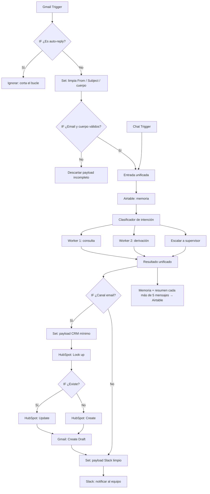

# Checkpoint 4 – Sincronización del Cerebro Agéntico con Ecosistemas de Negocio

Workflow de n8n **"Manager - Triaje Gomería (Módulo 4 - Integraciones)"**: un sistema multi-agente que recibe consultas de clientes (por chat o por mail), las clasifica, las deriva a un worker y sincroniza el resultado con el CRM, la casilla de soporte y el canal del equipo.

Parte del workflow del Módulo 3 (memoria y contexto) y le suma las integraciones con herramientas externas reales.

## Stack

| Rol | Herramienta | Autenticación |
|---|---|---|
| CRM | HubSpot | OAuth2 |
| Casilla de soporte | Gmail | OAuth2 |
| Canal del equipo de operaciones | Slack | OAuth2 |
| Memoria de casos | Airtable | Token de acceso personal |
| Modelos de IA | Google Gemini | API key |

## Archivos del repositorio

```
├── checkpoint4_agustin_aguilar.json   # Workflow principal (Manager)
├── workers/
│   ├── Worker 1.json
│   └── Worker 2.json
├── Capturas/
│   ├── Credentials lista.jpeg         # Sección Credentials de n8n (las 3 conexiones)
│   ├── Credential Gmail.jpeg          # Credencial de Gmail conectada
│   ├── Credential HubSpot.jpeg        # Credencial de HubSpot conectada
│   └── Credential Slack.jpeg          # Credencial de Slack conectada
└── README.md
```

## Cómo importarlo en n8n

El workflow principal llama a dos sub-workflows, así que el orden importa:

1. Importá primero los dos workers de la carpeta `workers/` (**Workflows → Import from File**).
2. Importá `checkpoint4_agustin_aguilar.json`.
3. En los nodos **Execute Workflow - Worker 1** y **Execute Workflow - Worker 2**, volvé a elegir cada worker en la lista (*From list*), porque los IDs cambian entre instancias.
4. Conectá tus propias credenciales (Gmail, HubSpot, Slack, Airtable y Gemini) en cada nodo que las use. Las credenciales no se exportan en el `.json`.
5. En el nodo de Slack, elegí tu canal. En los nodos de Airtable, elegí tu base y tabla (columnas: `Session_ID`, `Fecha de Actualización`, `Resumen Consolidado`, `Estado del Caso`, `Datos Clave`).

## Estructura del flujo



## Los 4 controles clave

1. **IF anti auto-reply** (inmediatamente después del trigger de Gmail). Ignora mails cuyo asunto contiene *Auto-reply*, *Out of office* o *Undeliverable*, o cuyo remitente es `no-reply@`, `noreply@`, `mailer-daemon` o la propia casilla de soporte. Neutraliza el bucle infinito de auto-respuestas. La comparación no distingue mayúsculas.
2. **Look up antes del Create en HubSpot.** Busca el contacto por email y decide entre Update y Create, para no generar contactos duplicados (error 409).
3. **Create Draft en Gmail.** El mensaje generado por la IA se guarda como borrador y nunca se envía solo: una persona lo revisa y lo envía (Human-in-the-loop). El workflow no tiene ningún nodo de envío.
4. **Nodos Set de limpieza de payload.** Antes de procesar el mail, un Set deja solo remitente, asunto y cuerpo (recortado a 2000 caracteres) y un IF descarta los que no tienen email o cuerpo (evita el error 400). Antes del CRM y de Slack, otros Set envían solo los campos mínimos, sin adjuntos ni objetos binarios, y el aviso a Slack lleva el resumen recortado a 300 caracteres.

Además, el campo `estado_crm` del aviso de Slack refleja lo que realmente pasó en HubSpot: dice `sincronizado` si el contacto se creó o actualizó, y `ERROR - revisar CRM` si falló.

## Mínimo privilegio

Cada conexión se autorizó solo con lo necesario para su función:

- **Gmail:** lectura de la casilla de soporte (trigger) y creación de borradores. Scopes autorizados: *(completar)*
- **HubSpot:** lectura y escritura de contactos. Scopes autorizados: *(completar)*
- **Slack:** publicar mensajes en un único canal. Scopes autorizados: *(completar)*

## Credenciales conectadas

Sección **Credentials** de n8n con las tres conexiones (HubSpot, Gmail y Slack, todas por OAuth2):


Detalle de cada conexión:

**Gmail (OAuth2)**


**HubSpot (OAuth2)**


**Slack (OAuth2)**


## Pruebas realizadas

Todas las pruebas se hicieron de forma manual desde el editor (Execute Workflow / Test step), usando datos fijados (pin data) en el trigger de Gmail.

| Prueba | Resultado |
|---|---|
| Mail normal, contacto nuevo | Crea el contacto en HubSpot, deja el borrador en Gmail y avisa a Slack |
| Mismo remitente por segunda vez | El Look up lo encuentra y va por Update, sin duplicar |
| Asuntos *Auto-reply*, *OUT OF OFFICE* y *Undeliverable* | Se ignoran, no se ejecuta nada más |
| Remitentes `no-reply@`, `noreply@` y `mailer-daemon` | Se ignoran |
| Mail enviado desde la propia casilla de soporte | Se ignora (evita el bucle al enviar un borrador) |
| Cuerpo vacío | Va a "Descartar payload incompleto" |
| Remitente sin nombre visible | `from_name` queda vacío y HubSpot crea el contacto solo con el email |
| Consulta por chat | No toca HubSpot ni Gmail; Slack informa `Canal: chat` y `CRM: no aplica` |
| HubSpot desactivado | Slack informa `ERROR - revisar CRM` |

## Notas

- Para probar sin publicar el workflow, usá **Fetch Test Event** en el Gmail Trigger. El filtro del trigger solo captura mails cuyo asunto contiene la palabra "consulta".
- El workflow no está publicado: corre solo en modo manual.
